# ClickCart

A local services marketplace connecting customers with service providers. ClickCart supports service discovery, booking requests, provider job management, messaging, cash payment records, reviews and platform commission administration in one application.

The repository contains a React frontend and a Spring Boot API backed by MongoDB. Customer, service provider and administrator accounts have separate workspaces and role-based navigation.

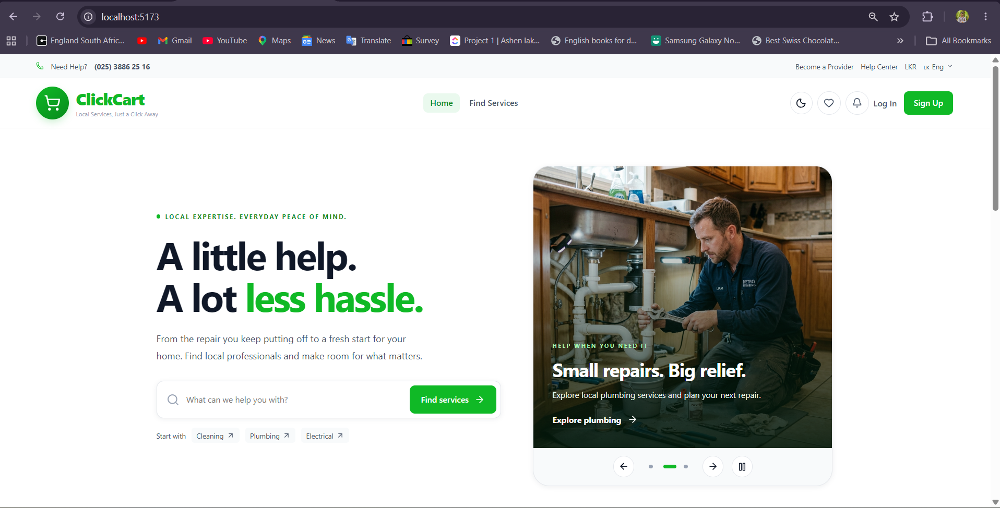
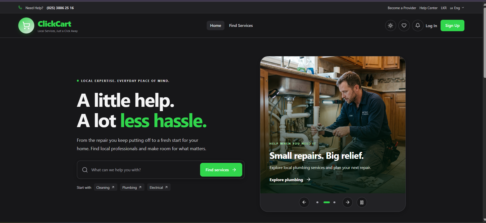

## Contents

- [Capabilities](#capabilities)
- [Technology](#technology)
- [Repository structure](#repository-structure)
- [Local setup](#local-setup)
- [Administrator accounts](#administrator-accounts)
- [Booking and cash payment workflow](#booking-and-cash-payment-workflow)
- [Application routes](#application-routes)
- [Build and verification](#build-and-verification)
- [Deployment considerations](#deployment-considerations)
- [Troubleshooting](#troubleshooting)
- [Development references](#development-references)

## Capabilities

### Customer workspace

- Browse and filter published services, view service details and request a booking.
- Track provider approval and booking progress.
- Message the assigned provider through booking conversations.
- View cash payment status, payment history and receipts.
- Review completed services and manage account details and passwords.

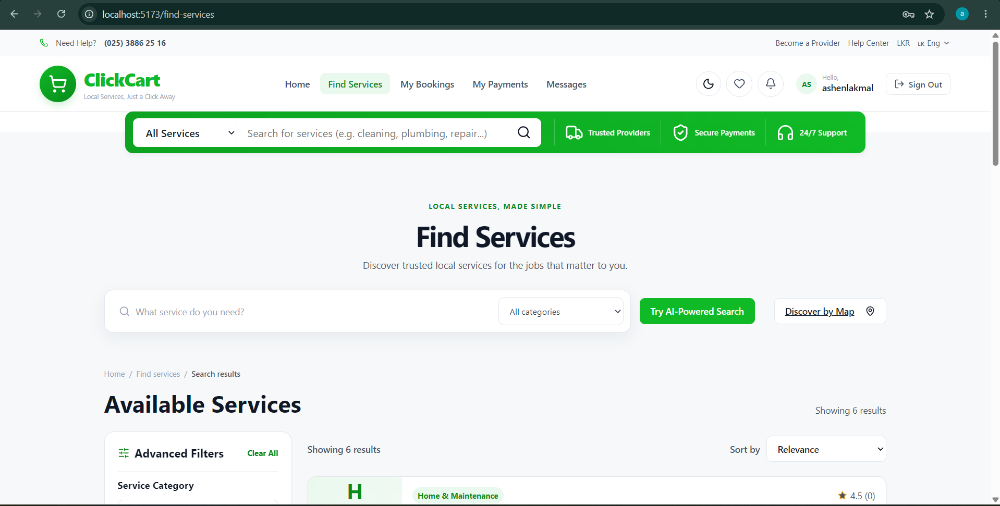
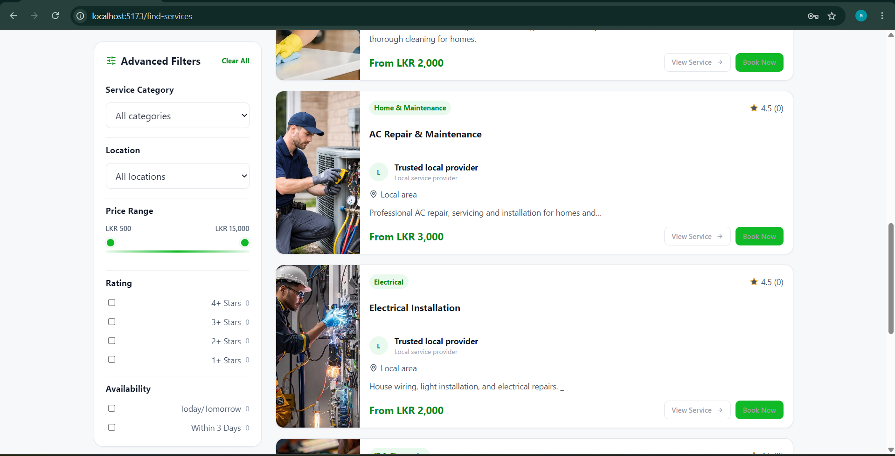
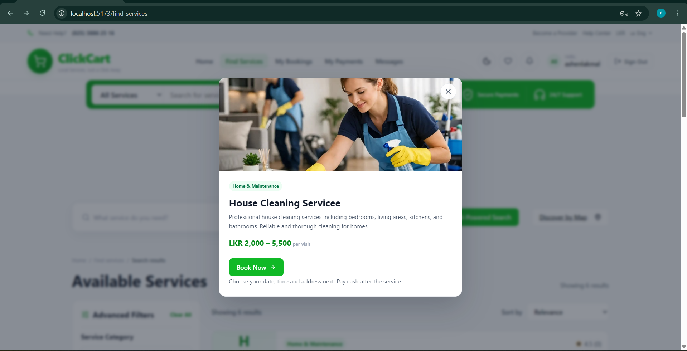

### Provider workspace

- Set up a provider profile and submit individual or business verification documents.
- Manage service listings, availability and service areas.
- Accept or decline booking requests and manage assigned jobs.
- Upload completion evidence and confirm receipt of customer cash payments.
- Access conversations, reviews, earnings and transaction records.

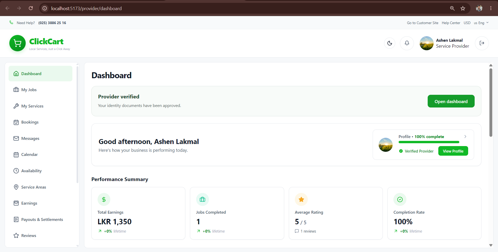
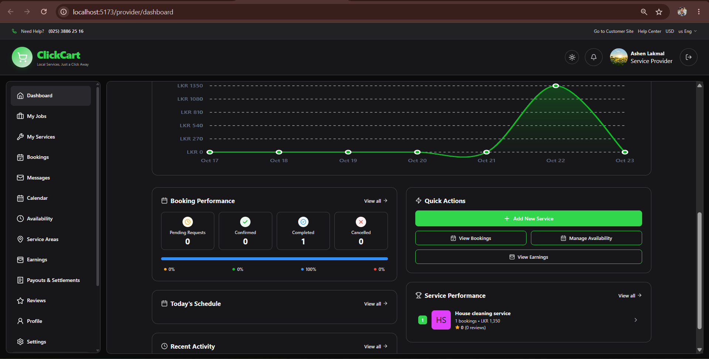


### Administrator workspace

- Sign in through a dedicated administrator login page.
- View database-backed user, booking and payment records.
- Review provider verification submissions and manage service categories.
- Configure commission rules and acknowledge offline commission settlements.
- Maintain an administrator profile and password.

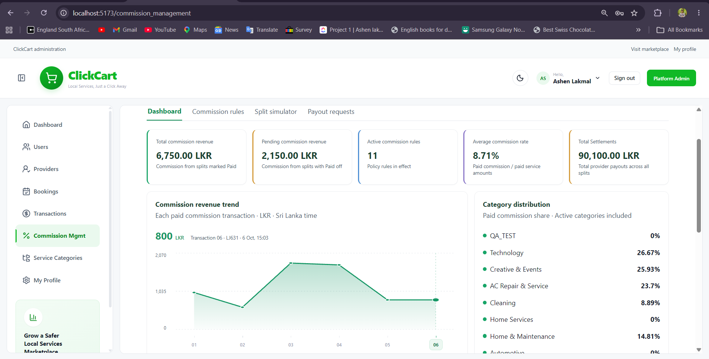
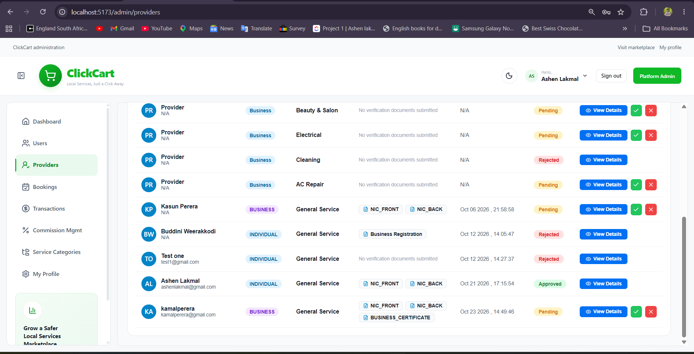


### Interface and integrations

The interface provides responsive layouts, light and dark themes, and a landing carousel that advances every four seconds. Playback respects reduced-motion preferences and pauses while hovered, focused or hidden.

Google Maps supports location discovery; Gemini supports AI-assisted features; SMTP supports email flows; Cloudinary supports media features. These integrations require their own configuration.

**Payment scope:** the current booking flow uses cash on service. The application records receipt of cash and offline commission settlement. It does not transfer money or provide a configured online card gateway. Card processing and payment webhooks are not available in this flow.

## Technology

- **Frontend:** React 19, Vite, JavaScript, React Router, CSS and Lucide icons.
- **Backend:** Java 17, Spring Boot 3.4, Spring Security and Maven Wrapper.
- **Persistence:** MongoDB with Spring Data MongoDB.
- **Communication:** REST APIs and STOMP/WebSocket messaging.
- **Authentication:** application JWTs, refresh sessions and BCrypt password hashes; an additional external JWT issuer configuration is required by the production security chain.

## Repository structure

```text
ClickCart/
├── frontend/
│   ├── src/
│   │   ├── components/       Shared UI, navigation and feature components
│   │   ├── config/           API and navigation configuration
│   │   ├── context/          Authentication and role context
│   │   ├── hooks/            Shared React hooks
│   │   ├── layouts/          Customer, provider and admin layouts
│   │   ├── pages/            Marketplace and workspace screens
│   │   ├── routes/           Route definitions and guards
│   │   ├── services/         API clients
│   │   └── styles/           Shared styles and themes
│   ├── public/               Public assets
│   ├── env.example           Frontend configuration template
│   └── package.json
├── backend/
│   ├── src/main/java/com/clickcart/
│   │   ├── config/           Application and security configuration
│   │   ├── controller/       HTTP endpoints
│   │   ├── dto/              Request and response objects
│   │   ├── model/            Persistent domain models
│   │   ├── repository/       MongoDB access
│   │   ├── security/         Authentication helpers
│   │   └── service/          Business workflows
│   ├── src/main/resources/
│   │   ├── application.example.yml
│   │   └── application-prod.yml
│   ├── src/test/             Backend tests
│   ├── tools/                Database administrator account utilities
│   ├── env.example           Backend configuration template
│   ├── pom.xml
│   └── mvnw / mvnw.cmd
├── docs/                     Engineering references and screenshot assets
│   └── images/               README screenshots
└── README.md                 Main project documentation
```

Local `.env` files, `application.yml`, uploaded files, build outputs and dependencies are not part of the source distribution.

## Local setup

### 1. Prerequisites

Install Git, a Java 17 JDK, Node.js 22.12 or later in the Node 22 release line, npm, and access to MongoDB. A system Maven installation is unnecessary because the backend includes Maven Wrapper. Initial dependency downloads require internet access.

Clone this repository and open its root directory. Start local MongoDB, or obtain an authenticated MongoDB connection URI and allow your development machine to reach it.

### 2. Create configuration files

Run these commands **from the repository root for a fresh checkout**. Do not overwrite existing local configuration.

Windows PowerShell:

```powershell
Copy-Item backend/env.example backend/.env
Copy-Item backend/src/main/resources/application.example.yml backend/src/main/resources/application.yml
Copy-Item frontend/env.example frontend/.env
```

macOS / Linux:

```bash
cp backend/env.example backend/.env
cp backend/src/main/resources/application.example.yml backend/src/main/resources/application.yml
cp frontend/env.example frontend/.env
```

Edit `backend/.env` before starting the API:

- Set `MONGODB_URI` and `DATABASE_NAME` to the intended database. The example uses local MongoDB and database `clickcart`.
- Replace `JWT_SECRET` with a unique random value of at least 32 bytes. Do not reuse the template placeholder. `CLICKCART_JWT_TTL` controls access-token lifetime in seconds.
- Keep `SERVER_PORT=8080` and `CORS_ALLOWED_ORIGINS=http://localhost:5173` for the documented local setup.
- `CLICKCART_SECURITY_ENABLED=false` selects the development security chain. It is for local development only and is rejected by production safety checks. Application login remains in use; this setting must not be treated as a production authorization configuration.
- Keep `AUTH_COOKIE_SECURE=false` only for local HTTP. `AUTH_COOKIE_SAME_SITE=Lax` is the same-site cookie setting.
- `ATTACHMENTS_DIR` and `CLICKCART_PROOF_DIR` must point to writable directories. Relative example paths resolve from the backend working directory.
- Configure `MAIL_USERNAME` and `MAIL_PASSWORD` for Gmail SMTP email delivery. Use an application password where required. Email-dependent workflows will not work with empty values.
- Configure `CLOUDINARY_CLOUD_NAME`, `CLOUDINARY_API_KEY` and `CLOUDINARY_API_SECRET` for Cloudinary uploads.
- Set `GEMINI_API_KEY` to enable Gemini-dependent features.

External-service credentials are supplied through environment configuration. Empty credentials leave the corresponding integrations unavailable.

Edit `frontend/.env`:

```dotenv
VITE_API_BASE_URL=http://localhost:8080/api
VITE_GOOGLE_MAPS_API_KEY=your-browser-map-key
```

Restrict the browser map key to your application's allowed origins and required APIs. All `VITE_` values are visible in the browser bundle; never place backend secrets there. The regular service directory can be used without the map integration.

The backend loads `.env` from its working directory or supported repository-relative locations. Shell environment variables take precedence over the custom dotenv loader. Run the backend from `backend/` to avoid ambiguous local configuration paths.

### 3. Start the backend

In a terminal:

```powershell
cd backend
.\mvnw.cmd spring-boot:run
```

On macOS / Linux, use `./mvnw spring-boot:run` instead. If necessary, first run `chmod +x mvnw`.

The API runs at `http://localhost:8080`; check `http://localhost:8080/api/health` after startup. Use the configured port if you changed it.

### 4. Start the frontend

In a second terminal, from the repository root:

```bash
cd frontend
npm ci
npm run dev
```

Open `http://localhost:5173`. On PowerShell installations that block npm scripts, use `npm.cmd ci` and `npm.cmd run dev`. Use `localhost` consistently instead of mixing it with `127.0.0.1` during session testing.

### 5. Create application accounts

Register separate customer and service provider accounts through `/register`. Providers must complete their profile and submit applicable verification documents. Until an administrator approves verification, only profile, verification and account settings are available. After approval, providers can publish services and manage bookings. Administrator accounts are created through the database utility below, not public registration. MongoDB collections are created as application workflows persist records; the administrator initializer also creates the admin collection and index.

## Administrator accounts

Administrator identities live in the **`admins`** collection. Customer and provider identities live in **`users`**. Administrator credentials are not configured in `.env`, and administrator records in `users` do not grant administrator access.

From the repository root in PowerShell:

```powershell
.\backend\tools\create-admin.ps1
```

The utility connects directly to MongoDB; the application server need not be running. Supply the database URI, database name, administrator email, name and password when prompted. Review the target and type `CREATE` to confirm. Password input is hidden. The password must satisfy the utility's validation: 8–64 characters, uppercase, lowercase and a number, and no more than 72 UTF-8 bytes.

The utility creates an active `PLATFORM_ADMIN` document with an `admin_` identifier and a BCrypt cost-12 password hash. Existing administrator accounts are not overwritten. Do not insert plaintext passwords into MongoDB.

To initialize only the collection and unique email index using existing database configuration:

```powershell
.\backend\tools\initialize-admins.ps1
```

Sign in at `http://localhost:5173/admin/login` using the account you created. Use **My Profile** to update administrator details and profile photo. Password reset requires working SMTP.

## Booking and cash payment workflow

Use separate browser profiles or an incognito window for the customer and provider sessions.

1. **Administrator:** configure an active commission rule for the category being tested. Complete provider verification review where applicable.
2. **Provider:** create an active service with a title, category and price, for example LKR 2,500.
3. **Customer:** find the service, select **Book Now**, enter a future date and time, contact details and service address, then select **Review booking → Send booking request**.
4. **Provider:** approve the request in **Bookings**. The accepted booking becomes an assigned job in **My Jobs**.
5. **Both participants:** use the booking conversation to discuss the work. Customer booking details provide **Message provider**; the provider can use the job chat or Messages workspace.
6. **Provider:** start the job, upload completion evidence and mark the job complete.
7. **Customer and provider:** exchange payment physically. Only after receiving the full cash amount should the provider select **Confirm cash received**. The customer can then view the paid receipt.
8. **Customer:** submit a review from the completed booking. Duplicate reviews for the same booking are rejected.
9. **Provider and administrator:** settle the platform commission offline. After receiving it, the administrator marks the matching commission transaction paid using its confirmation identifier.

With a matching 10% commission rule, an LKR 2,500 job produces an LKR 250 commission. Customer cash payment and provider commission settlement are separate real-world payments. Neither confirmation button initiates a bank transfer. Cash already held by the provider is not available for a second platform payout.

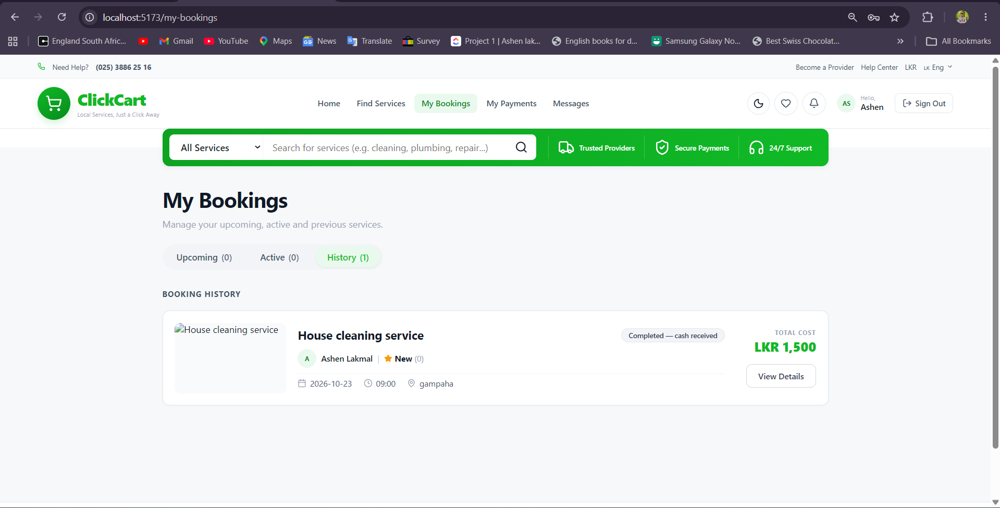
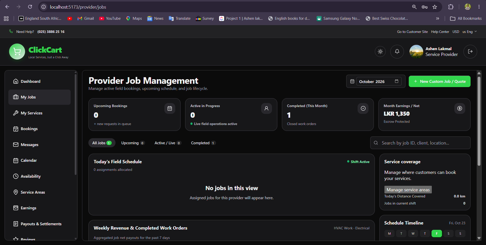
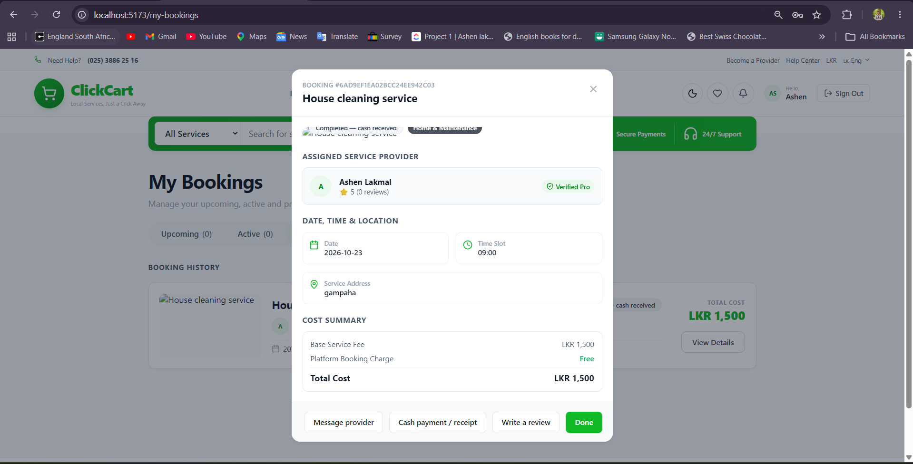

## Application routes

- **Public:** `/`, `/find-services`, `/find-services/map`, `/find-services/ai-search`, `/providers/:providerId`, `/login`, `/register`.
- **Customer:** `/booking/create?serviceId=...`, `/my-bookings`, `/messages`, `/reviews`, `/customer/payments`, `/customer/profile`.
- **Provider:** `/provider/dashboard`, `/provider/services`, `/provider/verification`, `/provider/bookings`, `/provider/jobs`, `/provider/messages`.
- **Administrator:** `/admin/login`, `/admin`, `/admin/providers`, `/admin/categories`, `/admin/users`, `/admin/bookings`, `/admin/transactions`, `/admin/profile`, `/commission_management`.

Protected routes require the corresponding account role. Obtain identifiers from actual database-backed listings rather than inventing service or booking IDs.

## Build and verification

Frontend production build, from `frontend/`:

```bash
npm run build
```

The output is `frontend/dist`. Use `npm run preview` to inspect the build locally; preview is not a production hosting server.

Backend tests and packaging, from `backend/`:

```powershell
.\mvnw.cmd test
.\mvnw.cmd package -DskipTests
```

On macOS / Linux, substitute `./mvnw`. Configuration and integration prerequisites may be required by individual tests. Run database-dependent checks against a dedicated test database, never a production database.

Booking, cash payment, review, conversation and commission regression tests are included under `backend/src/test`. Release verification covers the complete workflow for each role, including rejected requests, unauthorized access, failed uploads and duplicate actions. External integrations require environment-specific testing.

## Deployment considerations

- Build the frontend with its deployed `VITE_API_BASE_URL`; configure client-route fallback to `index.html` without rewriting API requests.
- Supply the backend configuration file and environment values in the deployment environment. Enable `SPRING_PROFILES_ACTIVE=prod`.
- Configure `CLICKCART_SECURITY_ENABLED=true`, a valid external `JWT_ISSUER_URI` and the expected `JWT_AUDIENCE`. The enabled security chain initializes an external issuer decoder in addition to application JWT handling; simply changing the flag is insufficient.
- Use HTTPS, `AUTH_COOKIE_SECURE=true`, explicit HTTPS `CORS_ALLOWED_ORIGINS` and a private signing secret. Prefer same-site frontend/API hosting. Review cookie and CSRF behavior before using cross-site hosting.
- Provide persistent upload storage, database access controls and backups. Configure SMTP, Cloudinary, Maps and Gemini only where those features are deployed.
- Keep demo seeding disabled. Production startup checks reject insecure cookies, invalid origin configuration and development security mode.
- Review authorization, recovery, media access and deployment-specific security headers before public release. Production readiness must be verified in the target environment.

Online card payments, verified gateway webhooks and automatic commission transfers are outside the current cash workflow.

## Troubleshooting

- **Missing configuration or unresolved placeholders:** create both `backend/.env` and `backend/src/main/resources/application.yml` from the templates. Check the backend working directory.
- **Database connection failure:** verify the URI, database name, server availability and network access. Do not paste credentials into an issue or screenshot.
- **Browser CORS or session errors:** match the browser origin to `CORS_ALLOWED_ORIGINS`, check `VITE_API_BASE_URL`, and restart both processes after changing environment files. If Vite selects another port, free port 5173 or explicitly allow the new origin.
- **Empty service directory:** publish an active service in the same database used by the API and clear search filters.
- **Booking rejected:** choose a future time, supply contact/address fields and ensure the selected service remains active with a valid price.
- **No paid receipt:** the job must be completed and its assigned provider must confirm cash receipt.
- **Maps, uploads, AI or email unavailable:** check the corresponding integration credentials, permissions and provider configuration.

## Development references

Additional engineering references are maintained in `docs/`. Module handovers describe their original implementation scope; this README documents the current setup and booking workflow.

- [Routing guide](docs/routing-guide.md)
- [Frontend guidelines](docs/frontend-guidelines.md)
- [Backend guidelines](docs/backend-guidelines.md)
- [API conventions](docs/api-conventions.md)
- [MongoDB guidelines](docs/mongodb-guidelines.md)
- [Development workflow](docs/development-workflow.md)
